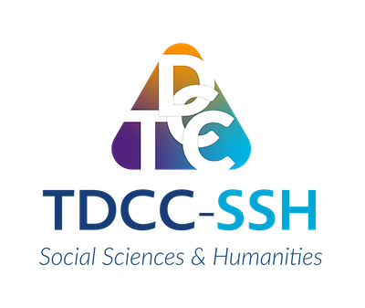
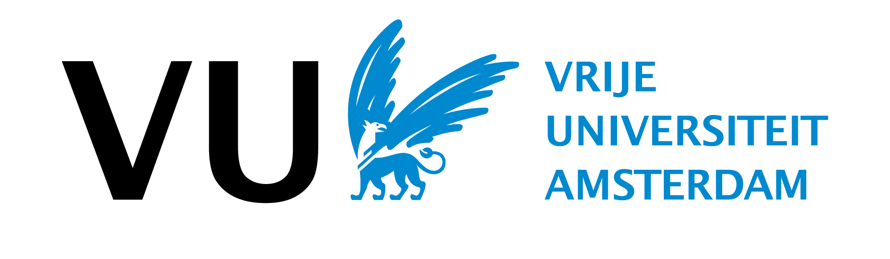
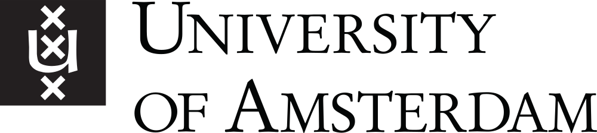
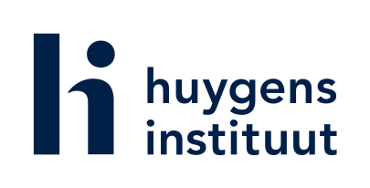
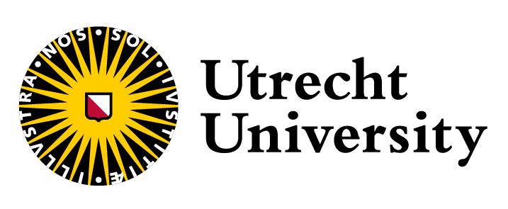

TDCC-SSH Project

<h1 class="fortes-hero__title">FORTES</h1>

Framework for Open Research on Trade and Economic Sources

## About the Project

**FORTES** tackles a key challenge in the humanities and social sciences: automatically extracting structured data from complex, handwritten archival tables like ledgers and account books.

This open-source project will build reusable digital methods to help researchers and heritage institutions make historical data more accessible and usable. Grounded in open standards (like **IIIF**, **Web Annotations**, and **RDF**), our methods will be tested across diverse collections.

FORTES is a collaborative effort, offering training, co-creation workshops, and practical guides to support others. All results will be **FAIR-compliant** and connect with existing infrastructures, making historical data easier to analyze, share, and reuse.

  TDCC-SSH
  IIIF
  W3C Web Annotations
  RDF
  FAIR Principles
  Open Source

## Key Pillars

  

    <h3 class="fortes-card__title">Structured Table Extraction</h3>
    

      Reusable digital methods to recognize layouts, rows, columns, and handwritten entries in complex archival ledgers and account books.
    

  

  

    <h3 class="fortes-card__title">Open Standards</h3>
    

      Grounded in IIIF, Web Annotations, and RDF, and tested across diverse collections to ensure interoperability.
    

  

  

    <h3 class="fortes-card__title">Training &amp; Co-Creation</h3>
    

      Supporting researchers and heritage institutions through hands-on training, co-creation workshops, and practical guides.
    

  

  

    <h3 class="fortes-card__title">FAIR &amp; Connected</h3>
    

      All results comply with FAIR principles and connect with existing research and heritage infrastructures.
    

  

## Project Members

  

    
Sabine Go

    
Vrije Universiteit Amsterdam

  

  

    
Leon van Wissen

    
University of Amsterdam

  

  

    
Gerhard de Kok

    
Huygens Institute

  

  

    
Lodewijk Petram

    
Huygens Institute

  

  

    
Christiaan van Bochove

    
Utrecht University

  

## Partners & Funder

  
  
  
  
  

